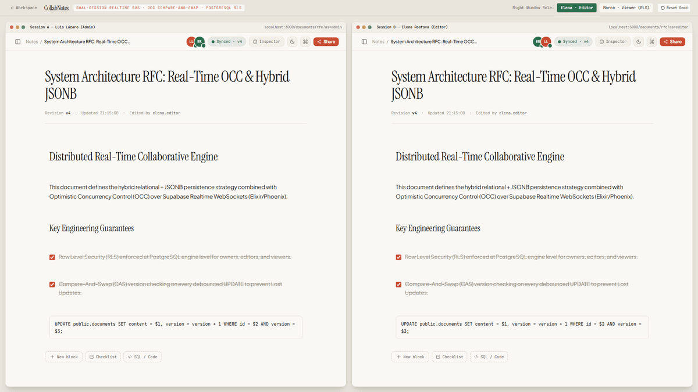
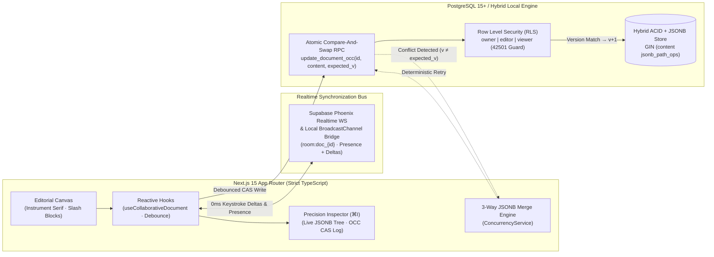
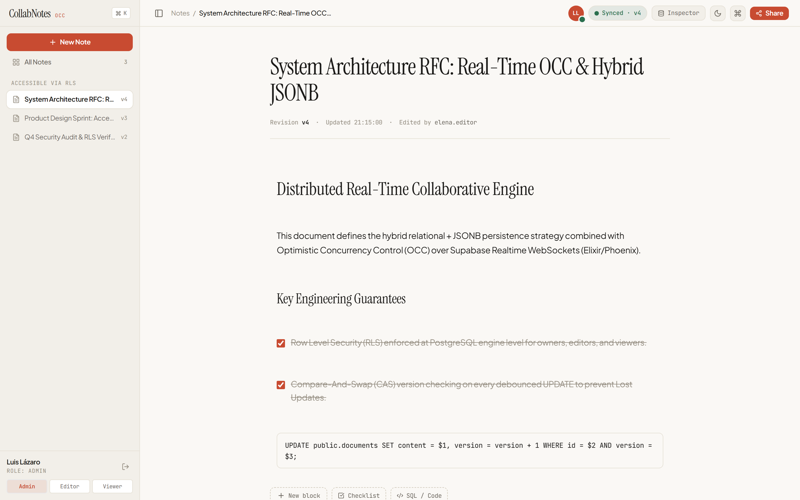
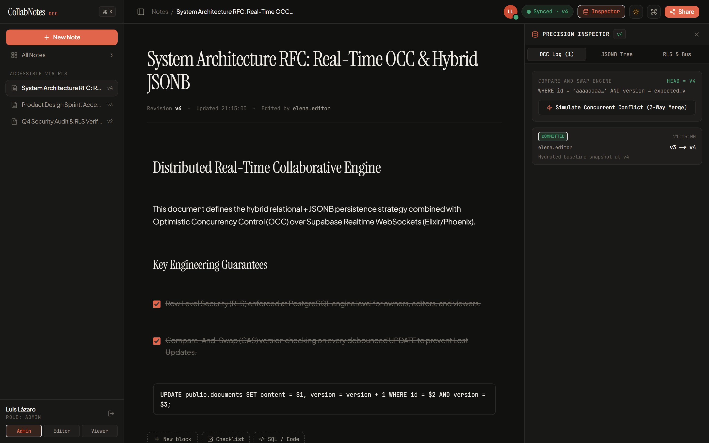

# CollabNotes

**Calm, real-time collaborative technical writing engineered for zero lost updates.**  
Built with **Next.js 15 (App Router)**, **Strict TypeScript**, **Supabase / PostgreSQL 15+ Row Level Security (RLS)**, **Hybrid Relational + JSONB Storage**, and **Optimistic Concurrency Control (Compare-And-Swap)**.

[-1A1917?style=flat-square&logo=next.js)](https://nextjs.org/)
[-2A6F4E?style=flat-square&logo=typescript&logoColor=white)](https://www.typescriptlang.org/)
[](./database/schema.sql)
[](./src/services/concurrency.service.ts)
[](./LICENSE)

<p align="center">
  
</p>

---

## Why CollabNotes?

Most collaborative note prototypes rely on naive "last-write-wins" overwrites, delegate authorization checks purely to frontend buttons, and wrap everything in generic dark-blue SaaS templates. **CollabNotes** takes a deliberate systems-and-craft approach:

1. **Zero Lost Updates via Optimistic Concurrency Control (OCC):** Every document row carries a monotonically increasing integer `version`. Debounced auto-saves execute an atomic Compare-And-Swap (`WHERE id = $1 AND version = $2`). When two editors save against the same base version concurrently, the engine detects the version mismatch, executes a **deterministic 3-way JSONB block-level merge** (`ConcurrencyService`), and commits `v + 1` without losing a single keystroke.
2. **Database-Enforced Row Level Security (RLS):** Access control (`admin`, `owner`, `editor`, `viewer`) is enforced at the storage perimeter (`database/schema.sql`). Viewers receive live cursors and content deltas over WebSockets, while unauthorized write attempts are rejected with PostgreSQL `SQLSTATE 42501`.
3. **Hybrid Relational (ACID) + JSONB Storage:** Combines strict foreign keys (`ON DELETE CASCADE`) and composite collaborator keys with a `JSONB` block array indexed via `GIN (content jsonb_path_ops)`.
4. **Editorial Atelier Design System:** Crafted with *Instrument Serif*, *Plus Jakarta Sans*, and *JetBrains Mono (`tabular-nums`)* across **Warm Paper (`#FAF8F5`)** and **Obsidian Ink (`#111110`)** themes, paired with a `Cmd/Ctrl + K` Command Palette and a collapsible `Cmd/Ctrl + I` Precision Engineering Inspector.

---

## Try It Locally in 30 Seconds (Zero-Config Mode)

No external API keys or cloud database setup are required to evaluate multi-user synchronization, OCC conflict resolution, and RLS guards locally:

```bash
git clone https://github.com/Thepimen/collab-notes-realtime.git
cd collab-notes-realtime
npm install
npm run dev
```

1. **Single-Window Workspace:** Open [`http://localhost:3000`](http://localhost:3000) and select any **1-Click Sandbox Session** on `/login` (or use password `CollabNotes2026!`):
   - **Admin (`admin@collabnotes.io`):** Luis Lázaro — Full workspace & collaborator management.
   - **Editor (`elena.editor@collabnotes.io`):** Elena Rostova — Real-time read/write access on shared specs.
   - **Viewer (`marco.viewer@collabnotes.io`):** Marco Silva — Live WebSocket presence, read-only RLS enforcement (`42501`).
2. **Instant Split-Screen Multi-User Studio:** Open [`http://localhost:3000/demo-stage`](http://localhost:3000/demo-stage) (or launch two browser tabs with `?as=admin` and `?as=editor`) to watch two isolated user sessions synchronize keystrokes, presence indicators, and OCC version increments in real time over `BroadcastChannel`.
3. **Run the Automated Concurrency & RLS Test Suite:**
   ```bash
   npm run test:concurrency
   ```

---

## System Architecture



---

## Editorial Interface (Warm Paper & Obsidian Ink)

| Warm Paper (Default Light Mode) | Obsidian Ink + Precision Inspector (`⌘I`) |
| :---: | :---: |
|  |  |

---

## Production Mode with Supabase

To connect **CollabNotes** to a live Supabase PostgreSQL 15+ cluster:

1. Copy `.env.example` to `.env.local` and configure your project credentials:
   ```bash
   cp .env.example .env.local
   ```
   ```env
   NEXT_PUBLIC_SUPABASE_URL=https://your-project-id.supabase.co
   NEXT_PUBLIC_SUPABASE_ANON_KEY=your-supabase-anon-public-jwt-key
   ```
2. Open your **Supabase SQL Editor** and execute:
   - [`database/schema.sql`](./database/schema.sql) — Provisions `public.app_role`, `profiles`, `documents`, `document_collaborators`, the `on_auth_user_created` trigger, `GIN` & composite indexes, strict RLS policies, `update_document_occ` PL/pgSQL RPC, and `supabase_realtime` publication.
   - [`database/seed.sql`](./database/seed.sql) — *(Optional)* Seeds sample collaborative architecture documents and roles.
3. Build and start the production server (or deploy via the included multi-stage `Dockerfile` & `docker-compose.yml`):
   ```bash
   npm run build
   npm start
   ```

---

## Keyboard Shortcuts

| Shortcut | Action |
| :--- | :--- |
| **`⌘ K`** / **`Ctrl + K`** | Open Command Palette (jump between notes, switch sandbox user, toggle theme, export `.md`) |
| **`⌘ I`** / **`Ctrl + I`** | Toggle Precision Engineering Inspector (`OCC Log`, `JSONB Tree`, `RLS & Bus`) |
| **`⌘ S`** / **`Ctrl + S`** | Force immediate atomic Compare-And-Swap (`CAS`) commit |
| **`/`** *(on empty block)* | Open inline block style selector (`H1`, `H2`, `Text`, `Todo`, `Code`, `Quote`) |

---

## Author & License

Engineered by **Luis Lázaro Pimentel** — [luislazaro-dev.netlify.app](https://luislazaro-dev.netlify.app) · [@Thepimen](https://github.com/Thepimen)  
Released under the [MIT License](./LICENSE).
