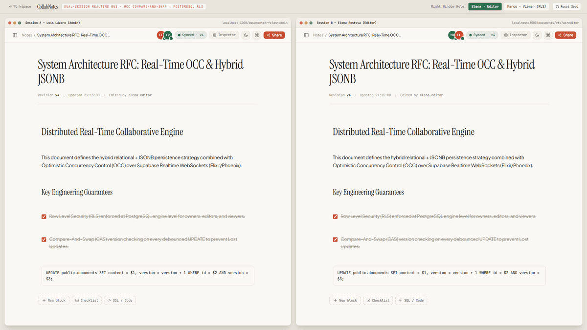

## CollabNotes Realtime `v1.0.0` — Initial Release

**Calm, real-time collaborative technical writing engineered for zero lost updates.**



### Highlights
- **Editorial Atelier Design System:** Crafted with *Instrument Serif*, *Plus Jakarta Sans*, and *JetBrains Mono (`tabular-nums`)* across **Warm Paper (`#FAF8F5`)** and **Obsidian Ink (`#111110`)** themes—zero generic AI SaaS templates.
- **Optimistic Concurrency Control (OCC):** Atomic Compare-And-Swap (`WHERE id = $1 AND version = $2`) paired with a deterministic **3-way JSONB block merge engine** (`ConcurrencyService`) to guarantee zero lost updates under concurrent writes.
- **Database-Enforced Row Level Security (RLS):** Strict `owner`, `editor`, and `viewer` policies (`SQLSTATE 42501` mutation guard) backed by a hybrid Relational (ACID) + `JSONB` (`GIN jsonb_path_ops`) schema.
- **Precision Engineering Inspector (`⌘I`) & Command Palette (`⌘K`):** Live JSONB document tree, real-time OCC CAS transaction log, RLS session telemetry, Markdown (`.md`) export, and instant sandbox role switching.
- **Zero-Config Local Multi-Session Studio (`/demo-stage`):** Tab- and frame-isolated sessions (`?as=admin|editor|viewer`) synchronized in real time via `BroadcastChannel` out of the box, with seamless drop-in compatibility for Supabase Cloud (`database/schema.sql` + `database/seed.sql`).

### Quick Start (30 Seconds)
```bash
git clone https://github.com/Thepimen/collab-notes-realtime.git
cd collab-notes-realtime
npm install
npm run dev
```
Open `http://localhost:3000` (or `http://localhost:3000/demo-stage` for the split-screen dual-user live demo).
